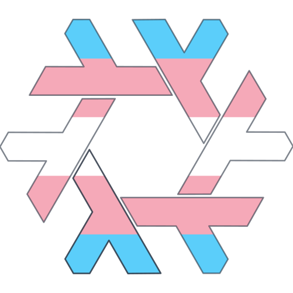
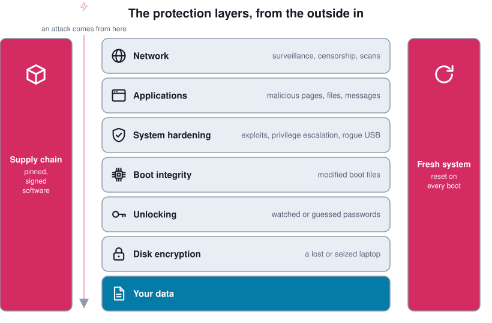
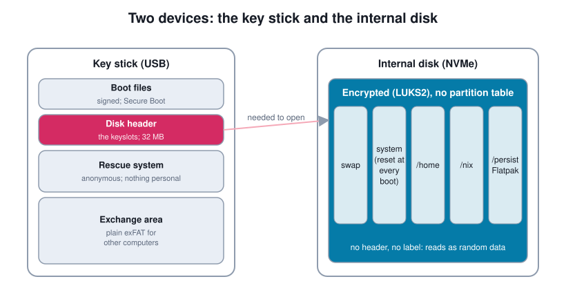
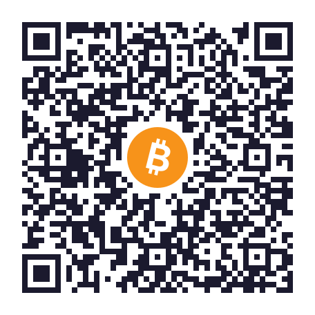
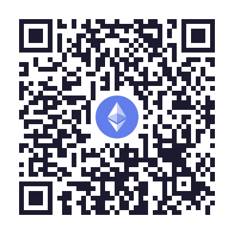
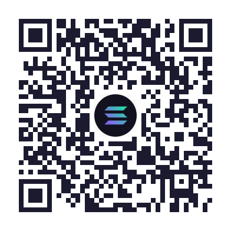
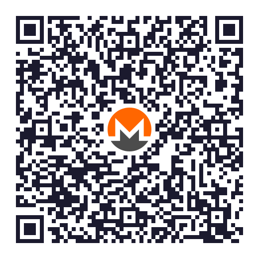
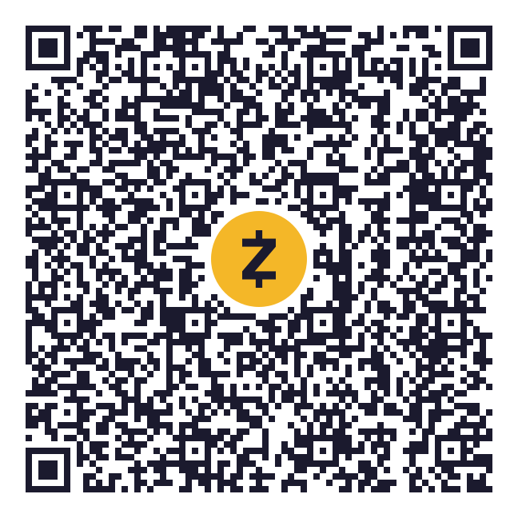

<p align="center">
  <picture>
    <source media="(prefers-color-scheme: dark)" srcset=".github/logo-dark.svg">
    
  </picture>
</p>

<h1 align="center">cobalt</h1>

<p align="center">A hardened, privacy-first NixOS laptop configuration.<br>
<strong>Documentation in six languages: <a href="https://nixos.ssf.network">nixos.ssf.network</a></strong></p>

cobalt is the NixOS configuration of a laptop used for sensitive work. It is built so that a lost or seized
laptop gives nothing away, so that tampering does not go unnoticed, and so that the whole system can be
audited and rebuilt from one declarative source. Every protection also states what it does *not* do.

<p align="center"></p>

## How it fits together

- **The disk is encrypted end to end**, and the information needed to unlock it lives on a separate USB
  **key stick**: without the stick the laptop does not even start. Unlocking takes a **YubiKey** (PIN and
  touch); a passphrase and a recovery key are the fallbacks. [Disk encryption and boot →](https://nixos.ssf.network/architecture/disk-and-boot/)
- **Secure Boot** with the laptop's own keys refuses modified boot files.
- **The system part of the disk is reset at every boot**; only an explicit list of things survives.
  [A fresh system on every boot →](https://nixos.ssf.network/architecture/ephemeral-system/)
- **Network:** a default-deny firewall, an encrypted proxy, encrypted DNS, a Wi-Fi address that changes from
  network to network, and Tor. [Network →](https://nixos.ssf.network/architecture/network/)
- **Sandboxes:** browsers and the document viewer in bubblewrap, messengers in Flatpak, AppArmor profiles.
  [Applications →](https://nixos.ssf.network/architecture/applications/)
- **Every key, password and PIN** is documented with what it opens, where it lives and where it is weak.
  [Keys and secrets →](https://nixos.ssf.network/architecture/keys/)

<p align="center"></p>

**Status:** builds, and installs in a QEMU rehearsal of the real procedure (offline install, first boot, rescue
system); not yet installed on hardware. The [status page](https://nixos.ssf.network/architecture/status/)
lists what is finished, what is planned and the known weaknesses.

## Repository layout

| Path | Contents |
|---|---|
| `flake.nix` | inputs, the host factory, the installer image outputs |
| `my/` | placeholders for identity and disk ids; the real values go in the git-ignored `my/private.nix` |
| `hosts/cobalt/` | the laptop: hardware support and the disk layout (disko) |
| `modules/nixos/` | the hardened module set: boot chain, impermanence, network, sandboxing, service hardening, users, desktop |
| `home/` | the operator's Home-Manager profile |
| `pkgs/` | bubblewrap sandbox wrappers for the browsers and the document viewer |
| `installer/` | the offline installer image, and the anonymous rescue system it writes to the key stick |
| `scripts/` | `flash-usb.sh` (macOS/Linux), `install.sh`, `vm-rehearsal.sh` |
| `secrets/` | sops-encrypted secrets |
| `example.CM.min.yaml` | skeleton of the mihomo profile that `secrets/mihomo.yaml` holds |

## Build

```sh
# evaluate only — works on any host with Nix
nix eval --raw .#nixosConfigurations.cobalt.config.system.build.toplevel.drvPath

# the installer image; `path:` so that the git-ignored my/private.nix is included
nix build path:.#images.installer
```

The logo is the NixOS snowflake by Tim Cuthbertson ([nixos-artwork](https://github.com/NixOS/nixos-artwork),
CC BY 4.0), recoloured with the transgender flag the way [hyfetch](https://github.com/hykilpikonna/hyfetch) does.

## Support

<details>
<summary>Donate to the maintenance of this configuration</summary>

<br>

- A ⭐ on the repository helps too.
- Cryptocurrency: scan a code with your wallet, or copy the address from the box next to it. After pasting,
  compare the first and last six characters. The same addresses are listed at <https://play.ssf.network/donate>.
  For a private donation, use Monero or shielded Zcash; on the other networks the transfer is public.

<!-- donate:start (a copy of the block the website's scripts/gen-donate.mjs writes. The data lives in .github/donate/; docs/site/scripts/check-donate.mjs fails the docs build if this block, the QR codes and addresses.json disagree) -->




 **Bitcoin**<br><sub>BTC, on the Bitcoin network</sub>

A Taproot address (it starts with bc1p). A few older wallets and exchanges cannot send to Taproot addresses yet.

```text
bc1pmuuq249apm4zs83kmgj2f444xjzdzu6amlc8j056h4mvx9l7wekqy2wgv6
```

<br clear="left">



 **Ethereum and EVM networks**<br><sub>ETH, stablecoins and other tokens on Ethereum, Base, Arbitrum, Optimism, Polygon, BNB Chain and other EVM networks</sub>

The same address on every EVM-compatible network: use whichever has the lowest fee for you.

```text
0x2f46f5b575c4ae379b58d4471b37d2ed55397f6d
```

<br clear="left">



 **Solana**<br><sub>SOL and SPL tokens such as USDC, on Solana</sub>

No memo or tag is needed. Capital and small letters are different characters in a Solana address, so copy it rather than typing it.

```text
2pZjiHjADu2P9qwxc58pkvRWngGqBn7vE3d9gncu34XJ
```

<br clear="left">



 **Monero**<br><sub>XMR, on the Monero network</sub>

A subaddress (it starts with 8). No payment ID is needed.

```text
85pC3mUAFWnTjYzkEWLS3VQBZdq7FEKSbbLmeiouBnsr5PKqhuenfXPBsMYt8C6da4DnrTJ3RdjksC44zZRE6YpvJaq5fcn
```

<br clear="left">



 **Zcash**<br><sub>ZEC, shielded, on the Zcash network</sub>

A unified address (it starts with u1) with shielded receivers only, and no transparent one. Send from a wallet that supports unified addresses; an exchange that can only withdraw to transparent t-addresses cannot send here.

```text
u146gwwuvfh97ufw4l329ry5ld0amxy740xjgj90wkx3qjkwc2yd6dysm6khfmk5m4mlrhkz65kmqnwxw74lytukpuqp4ymvtevsrf5fnt6uwlw4wjuvaj2saux70pjhzjhxz88z23940qgpgvzpuf0qxnehcv30y8pzu522laevjywy28
```

<br clear="left">

<!-- donate:end -->

</details>
